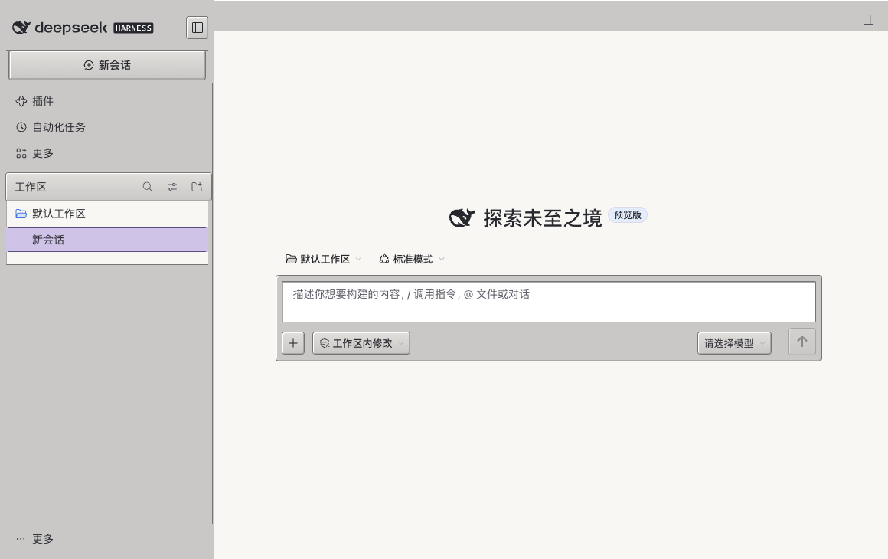
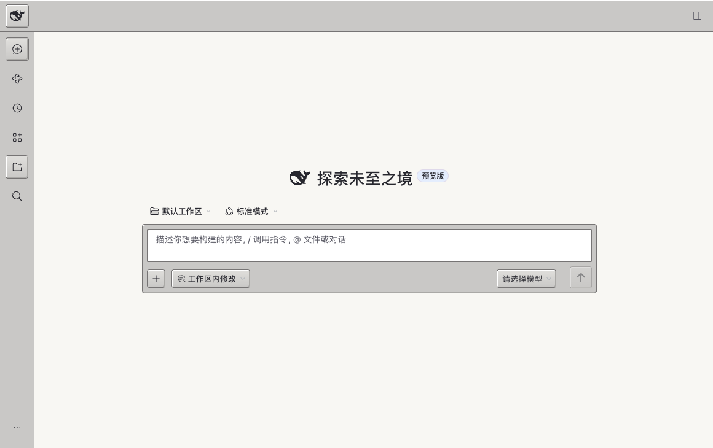
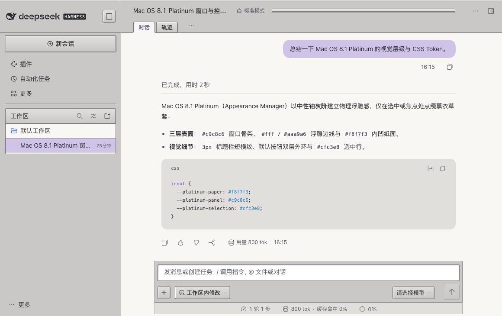
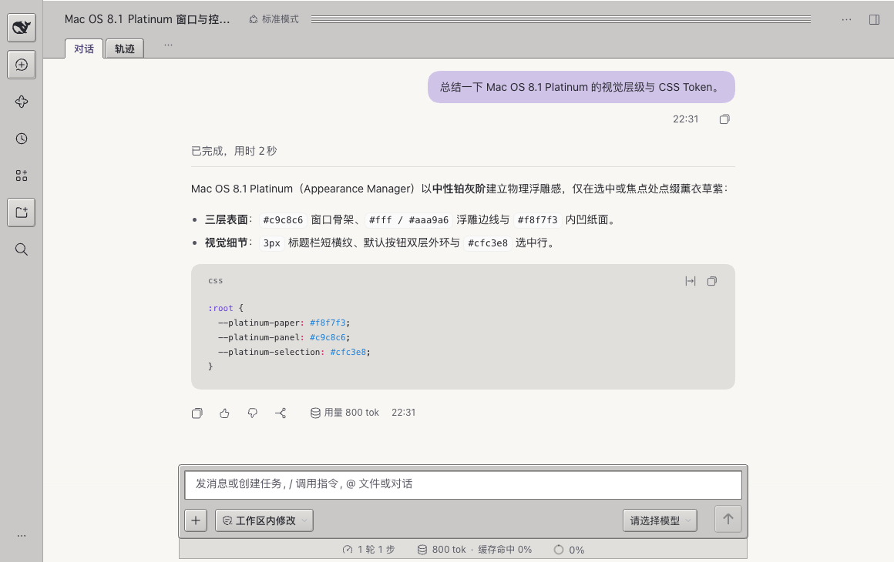
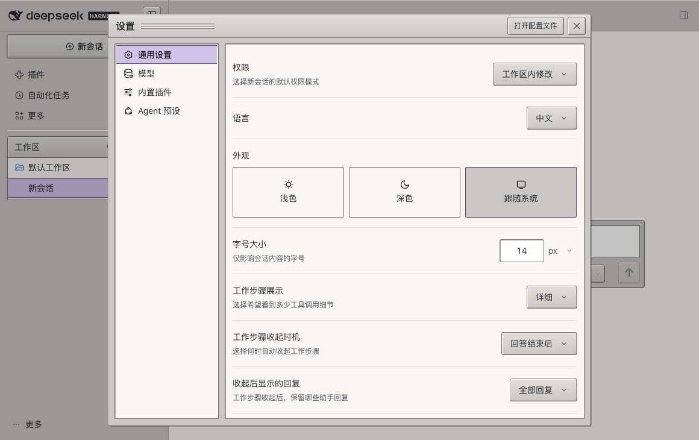
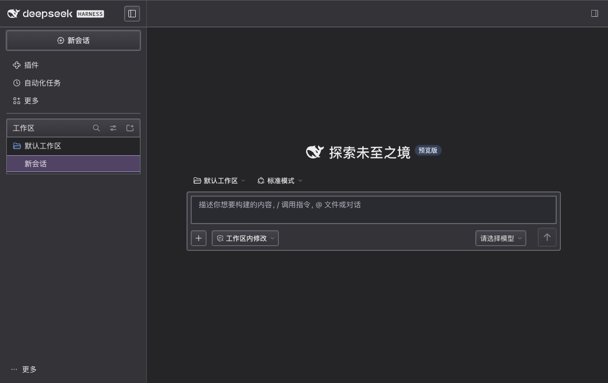

# Platinum for DSH Desktop

A restrained Mac OS 8.1 Platinum–inspired theme for DeepSeek Harness. Silver
window chrome, raised tabs and inset fields leave conversations, code and logs
easy to read. Includes light and dark palettes that follow DSH's appearance.

以 Mac OS 8.1 Platinum 为灵感的 DSH 桌面主题。铂灰窗口、短横纹标题栏、浮雕标签和凹槽输入框覆盖会话、设置和右侧工作区，浅色与深色配色跟随 DSH 外观。

## 界面预览 / Screenshots

### 新建对话（展开侧边栏 · 浅色 / New Chat — Sidebar Open, Light）



### 新建对话（收起侧边栏 / New Chat — Sidebar Collapsed）



### 历史对话（展开侧边栏 / Conversation — Sidebar Open）



### 历史对话（收起侧边栏 / Conversation — Sidebar Collapsed）



### 设置页（Settings）



### 深色模式（Dark Appearance）



## 安装 / Install

完全退出 DSH Desktop，运行以下命令，再重新打开。已在 macOS 上的 DSH Desktop
`0.2.2-rc.3` 验证。其他主题插件可能覆盖相同样式。

Quit DSH Desktop, run the command and reopen the app. Verified on macOS with
DSH Desktop `0.2.2-rc.3`.

```sh
dsh plugin --profile desktop add github:bin9317/dsh-theme-mac-platinum#v2.2.4
```

如果终端找不到 `dsh`，可使用桌面应用内置的 CLI。 If `dsh` is unavailable on
your PATH, use the macOS app's bundled CLI.

```sh
"/Applications/DeepSeek Harness.app/Contents/Resources/runtime/cli/bin/dsh" \
  plugin --profile desktop add github:bin9317/dsh-theme-mac-platinum#v2.2.4
```

## 卸载 / Uninstall

退出应用后运行以下命令，再重新打开。 Quit the app, remove the package and reopen it.

```sh
dsh plugin --profile desktop remove dsh-platinum-theme
```

## 构建 / Build

`npm run build` converts `theme.css` and the palette mappings in `build.mjs`
into the DSH client module. Run it before `npm pack`; the generated client is
committed so GitHub installs work without lifecycle scripts.
